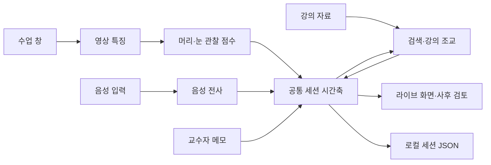

# 수업 참여도 분석 서비스

교수자가 온라인 수업 창을 선택하고 수업 중 관찰 신호와 기록을 같은 시간축에서 확인하는 로컬 실행형 보조 도구입니다. 영상 특징, 음성 전사, 교수자 메모와 강의 자료 제안을 함께 살펴보고 수업 후에 세션을 다시 검토할 수 있습니다. 최종 판단은 교수자에게 있습니다.

## 프로젝트 개요

온라인 수업에서는 설명 흐름과 학습자의 화면을 동시에 확인하기 어렵습니다. 이 프로젝트는 선택한 수업 창과 음성 입력을 분석해 교수자가 수업의 흐름을 돌아볼 수 있도록 돕습니다. 특정 참가자 배치에 맞춘 화면 좌표 대신 선택 창 전체를 분석 대상으로 사용합니다.

### 제안 배경과 목표

온라인 수업에서는 교수자가 설명을 이어 가면서 여러 참가자의 화면 변화와 수업 내용을 동시에 살피기 어렵습니다. 수업이 끝난 뒤에도 어떤 설명 구간에서 화면 관측이 어려웠는지, 어떤 자료를 다시 확인할지 기억만으로 되짚기 어렵습니다. 이 프로젝트는 수업 기록과 관찰 가능한 신호를 한 화면에 모아 교수자의 수업 성찰을 지원합니다.

제안서에서 지향하는 기능은 다음과 같습니다. 

- **수업 창 관찰:** 특정 타일의 고정 위치나 참가자 배치에 의존하지 않고 선택한 수업 창 전체를 분석합니다. 얼굴 방향, 머리 움직임, 표정 변화와 상체 움직임 등 관찰 가능한 특징을 활용하는 것이 목표입니다.
- **공통 시간축:** 영상 분석, 음성 전사, 교수자 메모를 수업 시작 기준으로 연결해 구간별 흐름과 관측 가능 여부를 함께 검토합니다.
- **수업 자료와 피드백:** 확정 전사와 교수자가 제공한 자료를 근거로 수업 중 자료를 제안하고, 수업 후 피드백을 제공합니다. 제안에는 근거 구간과 출처를 연결합니다.
- **로컬 기록:** 세션 결과를 공통 계약에 맞는 JSON으로 저장하고 다시 열거나 삭제할 수 있도록 합니다.

현재 기본 점수에는 머리 방향과 눈 감김이 사용됩니다. 

1. **수업 준비:** 제목과 동의를 확인하고 수업 창, 영상 분석, 음성 입력, 전사 모델과 강의 자료를 선택합니다.
2. **라이브 세션:** 창의 영상 특징과 음성 전사를 공통 수업 시계에 맞춰 표시합니다. 교수자는 구간 점수·관측 가능 상태·전사를 확인하고 메모를 남깁니다.
3. **강의 조교:** 확정 전사와 관련 강의 자료를 바탕으로 자료 또는 수업 제안을 만듭니다. 로컬 검색을 기본으로 하며 외부 AI는 선택 사항입니다.
4. **사후 검토:** 수업을 종료하면 전사·점수·메모·제안을 타임라인에서 살펴보고 피드백을 생성할 수 있습니다. 세션 JSON은 로컬에 저장·재열기·삭제합니다.



## 결과 해석과 개인정보

- 점수는 머리 방향·눈 감김으로 계산한 **관찰 점수**입니다. 학습자의 실제 집중도·이해도·성적이나 심리 상태를 확정하거나 개인 평가에 직접 사용하지 않습니다.
- 얼굴 또는 눈을 관측하기 어려운 구간은 0점이 아닌 관측 불가와 사유로 다룹니다. 다인 집계는 관측 가능한 대상의 참고값이며 전체 수강생의 참여율이 아닙니다.
- 수업 분석에는 동의가 필요합니다. 원본 영상·음성은 기본적으로 저장하지 않으며, 세션 JSON에는 계약에 정의된 집계·전사·메모·설정 등을 기록합니다.
- 외부 AI를 선택하면 확정 전사와 관련 자료 등의 텍스트가 해당 제공자에 전달될 수 있습니다. 로컬 검색을 선택하면 외부 AI 호출 없이 강의 자료를 활용합니다.

## 현재 구현 상태

- 프런트는 Streamlit 기반이며 수업 제목 입력, 창 연결, 수업 시작·종료, 메모, 세션 JSON 내보내기 기능을 제공합니다.
- 영상 분석은 MediaPipe로 얼굴 특징을 추출합니다. 개발자 모드에서는 캡처 화면, 랜드마크 오버레이, 후처리 특징과 관찰 점수를 확인할 수 있습니다.
- 머리 방향 70%와 눈 감김 30%를 결합한 관찰 점수를 통합부 구간 이벤트로 전달합니다. 재식별을 켜면 ID별, 끄면 단기 위치 트랙별로 계산한 유효 사람·시간 점수를 최근 5초 구간에서 가중 집계합니다. 관측 불가를 0점으로 처리하지 않으며 집중도·이해도 측정값으로 검증된 것은 아닙니다.
- 라이브 점수 카드와 사후 검토 점수에는 60점 미만 빨강, 60~80점 노랑, 80점 이상 초록 구간을 표시합니다. 점수가 없거나 임시 유지 중이면 회색으로 표시하며, 색상은 관찰 점수 안내일 뿐 집중도 판정이 아닙니다.
- 프런트는 faster-whisper(small 기본, base 선택)로 수업 음성을 말 멈춤 단위로 전사합니다. 강의 조교는 확정 전사와 유효 점수를 바탕으로 제안하며 PDF·PPTX 자료와 개인 API 사용은 선택 사항입니다. 출처 내용과 제안의 적합성은 교수자가 확인합니다. 실제 수업 자료에서의 정확도는 평가가 필요합니다. 자세한 내용은 [강의 조교 안내](ai_agent/README.md)를 참고하세요.
- 창 단위 캡처는 현재 Windows용입니다. macOS에서는 창 선택·캡처 기능을 사용할 수 없습니다.

## 저장소 구성

| 폴더 | 역할 |
|---|---|
| [frontend](frontend/README.md) | Streamlit 준비·라이브·사후 검토 화면과 세션 실행 |
| [video_recognition](video_recognition/README.md) | Windows 창 캡처, 얼굴 특징과 정면 보정 |
| [engagement_model](engagement_model/README.md) | 머리·눈 관찰 점수 계산과 구간 집계 |
| [faster_whisper_stt](faster_whisper_stt/README.md) | 음성 입력(루프백·마이크)과 faster-whisper 전사 |
| [ai_agent](ai_agent/README.md) | 강의 자료 검색, 수업 제안과 사후 피드백 |
| `integration/` | 공통 세션 시계, 이벤트 검증과 JSON 관리 |
| [공유용 데이터 계약](공유용_데이터_계약/README.md) | 모듈 간 이벤트·품질·시간 및 저장 형식 |


## 실행 환경과 준비물

통합 실행은 Windows와 Python 3.14 기준입니다. 영상 분석에는 캡처할 수업 창을, 음성 전사에는 마이크나 시스템 출력 캡처를 준비하세요. Face Landmarker 모델은 저장소에 포함되어 있으며 faster-whisper 모델은 첫 사용에 다운로드가 필요할 수 있습니다.

## 설치

### 설치 스크립트

Windows에 Python 3.14를 설치한 뒤, 내려받은 저장소 루트에서 PowerShell로 실행합니다.

```powershell
.\scripts\setup-dev.ps1
```

[설치 스크립트](scripts/setup-dev.ps1)가 `video_recognition/.venv`를 만들거나 기존 Python 3.14 환경을 재사용하고, 아래 수동 설치와 같은 순서로 패키지를 설치합니다. 의존성이 바뀌면 같은 명령을 다시 실행할 수 있습니다. 설치 후에는 [실행 및 사용](#실행-및-사용)의 명령으로 앱을 시작합니다.

### 수동 설치

Windows에서 저장소 루트 폴더를 열고 PowerShell에서 실행합니다. Python 3.14 환경을 기준으로 의존성을 고정했습니다.

```powershell
git clone https://github.com/kosh282/dgu_2026-2_OSS_teamG.git
cd dgu_2026-2_OSS_teamG
python -m venv video_recognition/.venv
video_recognition/.venv/Scripts/python.exe -m pip install --upgrade pip
video_recognition/.venv/Scripts/python.exe -m pip install -r video_recognition/requirements-integrated.txt
video_recognition/.venv/Scripts/python.exe -m pip install -r frontend/requirements.txt
video_recognition/.venv/Scripts/python.exe -m pip install -r faster_whisper_stt/requirements.txt
# 강의 조교 자료 읽기
video_recognition/.venv/Scripts/python.exe -m pip install -r ai_agent/requirements.txt
```

## 실행 및 사용

```powershell
video_recognition/.venv/Scripts/python.exe -m streamlit run frontend/app.py
```

브라우저에서 터미널에 표시된 주소(보통 `http://localhost:8501`)를 엽니다. 수업 제목과 동의를 입력한 뒤 세션을 시작합니다. 얼굴 검출을 포함한 영상 분석, 관찰 점수, 음성 전사는 기본 켜짐이며 강의 조교는 수업 시작 시 자동으로 시작합니다. 추가 연산이 필요한 얼굴 재식별은 기본 꺼짐이며, 기본 영상 분석은 단기 위치 추적을 사용합니다. 영상 분석을 사용하면 수업 창도 선택합니다. 개발자 모드에서 영상 오버레이와 분석값을 확인할 수 있고, 수업을 마치면 세션 JSON을 내려받을 수 있습니다.

## 데모

Windows에서 웹캠 영상 창을 캡처하는 분석 데모:

```powershell
video_recognition/.venv/Scripts/python.exe -m video_recognition.webcam_test
```

macOS에서는 웹캠 프레임을 직접 분석하는 별도 데모를 사용합니다. Mac용 가상환경과 영상 분석 의존성 설치 방법은 [영상 분석 안내](video_recognition/README.md#macos-웹캠-직접-입력)를 참고하세요.

```bash
video_recognition/.venv/bin/python -m video_recognition.webcam_test_mac
```

Windows 데모는 프런트 개발자 모드와 같은 패널과 다인 Gaussian·눈 감김 점수 경로를 사용합니다. 기본은 임시 위치 추적이며 `--reidentify`로 세션 내 얼굴 재식별을 선택할 수 있습니다. 보정은 자동으로 시작하며, `C`는 재보정, `V`는 오버레이, `[`·`]`는 진단 페이지 전환, `Q`는 종료입니다. 원본 영상과 개인별 특징은 저장하지 않으며 집계 진단 로그는 `video_recognition/demo_logs/`에 생성됩니다. Mac 데모는 별도 출력과 웹캠 직접 입력을 사용하며 Windows 수업 창 캡처를 대신하지 않습니다.

프런트와 Windows 웹캠 데모는 `video_recognition/group_developer_view.py`의 모델 생성·개발자 패널을 공유합니다. 진단 페이지에서 관측 중인 임시 트랙별 총점, 머리·눈 점수와 보정 각도·보류 사유를 확인할 수 있습니다. 개인별 값은 화면의 임시 진단 정보이며 세션 결과에 저장하지 않습니다.

자세한 사용법은 [프런트 안내](frontend/README.md), [음성 전사 안내](faster_whisper_stt/README.md), [영상 분석 안내](video_recognition/README.md), [점수 모델 안내](engagement_model/README.md), [강의 조교 안내](ai_agent/README.md)를 참고하세요.

## 개발·진단 테스트 명령어

아래 명령은 Windows PowerShell에서 **저장소 루트**를 기준으로 실행합니다. 위 설치 단계가 먼저 필요합니다. 옵션의 `--`는 긴 대시가 아닌 일반 하이픈 두 개입니다.

### 프런트 실시간 개발자 화면

```powershell
video_recognition/.venv/Scripts/python.exe -m streamlit run frontend/app.py
```

수업 창을 연결하고 영상 분석을 선택해 수업을 시작한 다음, 셋째 행 오른쪽 **분석 상태 · 개발자 도구 → 개발자 모드 켜기**를 누릅니다. 웹캠 모델 데모와 같은 별도 창에서 실제 분석 화면, 관찰 점수와 자세 입력 품질을 확인합니다. 창에 초점을 두고 `V`로 오버레이, `[`·`]`로 상세 페이지, `C`로 재보정, `Q`로 창 숨기기를 할 수 있습니다. 모델이 꺼졌거나 관측이 불가능하면 점수는 표시되지 않습니다. 다인 모드 점수는 전체 집계이며 개별 각도와 구분해야 합니다. 개발자 화면은 분석기와 같은 프레임을 사용하며 별도 카메라는 열지 않습니다.

### 웹캠 모델·각도 진단

```powershell
video_recognition/.venv/Scripts/python.exe -B -m engagement_model.webcam_demo --single-model --debug
```

카메라를 정면으로 보고 `C` 또는 화면의 보정 버튼을 누릅니다. `V`는 오버레이, `D`는 상세 진단, `[`·`]`는 페이지 전환, `Q`는 종료입니다. 현재 방향 점수와 5초 집계는 관찰값입니다.

좌우 비대칭을 조사하려면 아래 명령을 사용합니다. 정면을 보고 `C`를 누른 뒤 정면·왼쪽·정면·오른쪽·정면 순서로 화면의 이동 및 유지 안내를 따릅니다.

```powershell
video_recognition/.venv/Scripts/python.exe -B -m engagement_model.webcam_demo --yaw-diagnostic --yaw-log --single-model --diagnostic-move-seconds 3 --diagnostic-hold-seconds 5
```

초별 각도·기준점 변화 통계는 `engagement_model/diagnostic_logs/`에 저장됩니다. 영상과 기준점 원본은 저장하지 않지만 진단 수치는 민감할 수 있으므로 사용 후 직접 삭제하세요. 자세한 해석과 한계는 [웹캠 진단 안내](engagement_model/docs/webcam-diagnostics.md)를 참고하세요.

### 수업 창 캡처 확인

```powershell
video_recognition/.venv/Scripts/python.exe -m video_recognition.integrated_analysis --list
video_recognition/.venv/Scripts/python.exe -m video_recognition.integrated_analysis --hwnd 12345 --session class-test.json
```

먼저 수업 프로그램 창을 열고 첫 명령으로 표시된 번호를 확인한 뒤, `12345`를 실제 번호로 바꿉니다. 두 번째 명령은 별도의 분석을 실행하고 결과 JSON을 저장합니다. 자세한 안내는 [영상 분석 안내](video_recognition/README.md)를 참고하세요.

### 자동 테스트와 CI

GitHub Actions의 [Validate 워크플로](.github/workflows/validate.yml)는 Python 3.14에서 계약·통합, 모델, 프런트, 장치 없는 영상 회귀 검사를 나누어 실행합니다. 저장소 루트에서 같은 검사를 실행하려면 다음 명령을 사용합니다.

```powershell
video_recognition/.venv/Scripts/python.exe -B -m unittest discover -s integration/tests -t . -v
video_recognition/.venv/Scripts/python.exe -B -m unittest discover -s engagement_model/tests -v
video_recognition/.venv/Scripts/python.exe -B -m unittest discover -s frontend/tests -v
video_recognition/.venv/Scripts/python.exe -B -m unittest video_recognition.test_window_enumeration video_recognition.test_layout_regions video_recognition.test_full_frame_schedule -v
video_recognition/.venv/Scripts/python.exe -B -m unittest discover -s experimental_vision -v
```

CI 검사는 실제 카메라·수업 창·마이크, 외부 AI API, 실제 수업 성능을 검증하지 않습니다. 장치·API 환경 검증은 별도로 기록해야 합니다.

전체 코드 검토의 수정 내역, 우선순위와 검증 한계는 [코드베이스 검토 보고서](docs/codebase-review.md)를 참고하세요.
