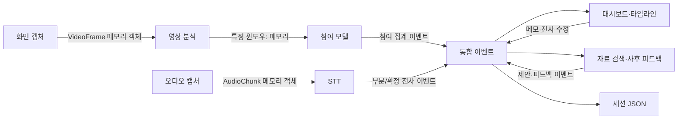

# 팀 공통 데이터 계약 v0.1.0

> 상태: **구현 시작을 위한 잠정 계약** · 기준: 중간발표 v3 및 제출 제안서 · 작성일: 2026-10-29
>
> 참여도 평가 모델, 점수 척도, 입력 특징과 집계식은 미정입니다. 이 문서는 모듈 연결을 위한 공통 틀을 정하며, 모델 선택이나 점수의 타당성을 확정하지 않습니다. 팀 회의에서 변경사항을 합의하고 버전을 갱신하세요.

## 1. 목적과 사용법

실시간 온라인 수업 창과 음성을 분석하는 팀의 각 파트가 같은 시간과 데이터 형식을 사용하기 위한 기준입니다. 아래 표에서 자신의 입력과 출력을 확인하고, [`examples/session.json`](examples/session.json)을 합성 데이터로 사용해 화면·저장·조교 연결을 시작할 수 있습니다. 이 문서는 프로그래밍 언어별 클래스 구현이나 최종 JSON Schema가 아니라 사람이 읽는 인터페이스 계약입니다.

## 2. 역할별 입출력

| 담당 | 입력 | 출력 | 상대 파트와 합의할 것 |
|---|---|---|---|
| 고성혁 · 총괄/통합 | 각 파트 이벤트, 설정 및 세션 상태 | 세션 ID와 공통 시계, 이벤트 전달, JSON 저장·재열기 계약 | 이벤트 유형과 버전, 시간 정렬, 저장 경계, 오류/종료 동작 |
| 장은주 · 화면/영상 | `VideoFrame`: 창 전체 프레임과 캡처 시각 | 모델용 `FeatureWindow`와 품질 정보; 모델 전에도 분석 상태 이벤트 | 색상·해상도, 특징 이름/단위, 결측·보류 사유, 프레임 밀림 정책 |
| 정영진 · 오디오/STT | `AudioChunk`: 오디오 샘플과 시작/종료 시각 | `transcript_partial`, `transcript_final` | 모델 입력 샘플레이트·형식, 발화 ID, 부분 결과 갱신과 종료 시 확정 정책 |
| 조해민 · 화면/대시보드 | 공통 이벤트 및 저장 JSON | `note_created`, `transcript_edited`; 이벤트 기반 UI 표시 | 시각·가능률·분모 표시, 부분 전사 교체, 수정/재열기 반영 |
| 허예원 · 참여 모델/평가 | `FeatureWindow`, 별도 주석 데이터와 모델 설정 | 모델이 정해진 뒤 `engagement_window`; 모델 미준비 시 `analysis_status` | 특징 목록·단위, 결측 처리, 모델/점수 정의, 윈도우·분모와 검증 기준 |
| 강의 조교 기능 담당 · 회의에서 배정 | 확정/수정 전사, 메모, 집계 이벤트, 자료 인덱스 | `resource_suggestion`, `post_session_feedback` | 근거 이벤트 ID, 자료 출처·페이지, 제안 상태, 전사 수정 반영 |

영상과 오디오 캡처 담당의 세부 분담, 강의 조교와 저장 구현 담당은 팀에서 최종 배정합니다. 역할 표는 제안서의 기존 담당과 통합 인터페이스를 연결한 것입니다.

## 3. 공통 규칙

| 항목 | 계약 |
|---|---|
| JSON 인코딩·이름 | UTF-8, 키는 `snake_case` |
| ID | `session_id`, `event_id`, `utterance_id`, `document_id`는 UUID 문자열. ID는 만들어진 뒤 변경하지 않음 |
| 공통 시각 | 세션 시작을 0으로 하는 정수 밀리초. 실행 중 세션 공통 단조 증가 시계 사용 |
| 구간 | `[start_ms, end_ms)`: 시작 포함, 종료 제외. 시점 이벤트는 `start_ms == end_ms` |
| `created_ms` | 실행 중 이벤트 생성의 수업 상대 시각. 대상 구간의 종료와 별개이며 지연 측정에 사용. 종료 후 재열기에서 만든 이벤트는 `null`과 `created_at_utc` 사용. UI 표시 시각은 별도 계측 |
| 실제 시작 날짜 | `session.started_at_utc`: UTC ISO 8601 문자열. 타임라인 계산에 사용하지 않음 |
| 비율 | 0.0~1.0 실수, 알 수 없으면 `null`. UI에서만 백분율로 변환 |
| 값 없음 | 숫자 0과 의미가 다른 미산출/관측 불가는 `null`과 품질 상태·사유로 표기 |
| 확장 | 공통 필드 의미를 바꾸지 않음. 새 선택 필드/이벤트는 버전과 변경 기록을 남기고, 알 수 없는 선택 필드는 무시 가능하도록 구현 |

## 4. 이벤트 공통 형식

실행 중 파트 간 전달되는 결과 이벤트의 공통 외피입니다. `payload`의 필수 항목은 이벤트 종류별 표를 따릅니다. 아래 문자열은 타입 설명이며 실제 데이터가 아닙니다.

| 필드 | 타입 | 필수 | 의미 |
|---|---|---|---|
| `schema_version` | string | 예 | 이 이벤트 계약의 버전, 현재 `0.1.0` |
| `session_id` | UUID string | 예 | 세션 식별자 |
| `event_id` | UUID string | 예 | 이벤트 식별자 |
| `event_type` | string | 예 | 아래 목록의 이벤트 유형 |
| `start_ms`, `end_ms` | integer | 예 | 이벤트 대상 수업 상대 시각, `0 <= start_ms <= end_ms` |
| `created_ms` | integer 또는 null | 예 | 실행 중 이벤트 생성 수업 상대 시각. 종료 후 재열기에서 생성하면 `null` |
| `created_at_utc` | string 또는 null | 예 | 종료 후 재열기에서 생성하면 실제 생성 시각 UTC ISO 8601. 실행 중에는 `null` 가능 |
| `payload` | object | 예 | 이벤트 유형별 데이터 |
| `quality` | object | 예 | `status`, `reason_codes` |
| `provenance` | object | 예 | 생성 모듈과 적용 버전 |

`quality.status`는 `valid`, `partial`, `not_observable` 중 하나입니다. `reason_codes`는 문자열 배열이며 사유가 없으면 `[]`입니다. `provenance`에는 `module`, `config_version`을 넣고, 모델이 사용된 경우 `model_id`, `model_version`을 추가합니다. 모델이 미정이거나 사용되지 않은 경우 두 모델 필드는 `null`로 둡니다. `module`은 `capture`, `vision`, `model`, `speech`, `ui`, `assistant`, `system` 중 하나입니다.

### 품질 사유 초안

`face_not_found`, `tile_too_small`, `occluded`, `landmark_low_quality`, `scene_transition`, `baseline_unavailable`, `audio_unavailable`, `model_not_configured`, `insufficient_observation`. 원인을 구분할 수 없으면 근거 없이 특정 사유를 붙이지 말고 `unknown`으로 처리합니다. 실제 적용 기준은 담당 파트가 합의합니다.

## 5. 실행 중 입력 객체

프레임과 오디오 샘플은 JSON으로 직렬화하지 않고 메모리에서 파트 간 전달합니다. 아래는 인터페이스 설명이며 실제 Python 클래스 이름·구현은 팀이 정합니다. 프레임·오디오와 개인별 중간 특징은 저장 JSON이나 로그에 넣지 않습니다.

### `VideoFrame`: 캡처 → 영상

| 필드 | 타입 | 의미 |
|---|---|---|
| `session_id` | UUID string | 세션 ID |
| `frame_id` | integer | 세션 내 증가하는 프레임 번호. 누락이 있을 수 있음 |
| `capture_ms` | integer | 프레임 캡처 수업 상대 시각 |
| `width`, `height` | integer | 실제 전달 배열의 픽셀 크기 |
| `color_format` | string | 우선 `BGR` 제안. 영상 담당이 변환 책임을 확인 |
| `image` | array | 메모리 내 이미지 배열. JSON 저장 금지 |

### `AudioChunk`: 캡처 → STT

| 필드 | 타입 | 의미 |
|---|---|---|
| `session_id` | UUID string | 세션 ID |
| `chunk_id` | integer | 세션 내 증가하는 청크 번호 |
| `start_ms`, `end_ms` | integer | 청크의 수업 상대 시작·종료 시각 |
| `sample_rate_hz` | integer | 실제 전달 샘플의 초당 샘플 수 |
| `channels` | integer | 실제 채널 수 |
| `sample_format` | string | 실제 샘플 타입, 예: `float32` |
| `samples` | array | 메모리 내 오디오 샘플. JSON 저장 금지 |

초기 실험값으로 16,000 Hz·mono·float32를 검토하되 **선택한 한국어 STT 모델의 요구 규격을 확인한 뒤 확정**합니다. 오디오 누락/장치 전환은 무음으로 위장하지 말고 별도 상태로 알립니다.

## 6. 이벤트별 `payload` 계약

각 이벤트는 4절의 공통 필드를 모두 가집니다. 아래 표는 `payload` 내부만 설명합니다. 개별 필드가 `null`일 수 있는 경우를 명시했습니다.

### 음성 전사

| 이벤트 | 필수 `payload` | 처리 규칙 |
|---|---|---|
| `transcript_partial` | `utterance_id`, `revision` 정수, `text` 문자열 | 실행 중 UI 임시 표시. 동일 발화의 더 높은 `revision`으로 교체. 저장 JSON에는 넣지 않음 |
| `transcript_final` | `utterance_id`, `revision`, `text`, `is_edited: false` | 확정 발화. 동일 `utterance_id`당 확정 결과 하나를 현재 강의록에 유지 |
| `transcript_edited` | `utterance_id`, `revision`, `text`, `is_edited: true`, `replaces_event_id` | 기존 확정/수정 이벤트를 대체. `revision`을 증가시키며 대체 대상 ID를 명시 |

`transcript_edited`의 `start_ms/end_ms`는 수정 대상의 시간 구간을 유지합니다. 저장 JSON에는 **각 발화의 현재 확정본 하나만** 저장합니다. 수정 이벤트를 저장할 때 `replaces_event_id`는 참조용 외부 이력으로 남을 수 있으며, 대상 원본의 저장 여부는 별도 결정 전까지 보장하지 않습니다. 조교 결과는 생성 당시 근거 전사 `event_id`를 기록하고, 참조 전사가 수정되어 더 이상 현재 강의록에 없으면 UI에서 근거 갱신 필요로 표시합니다.

### 영상/모델

| 이벤트 | 필수 `payload` | 처리 규칙 |
|---|---|---|
| `analysis_status` | `component`, `state` (`ready`, `running`, `unavailable`, `stopped`), `message` | 캡처/영상/모델/STT 등의 상태 전달. 모델 미설정이면 `unavailable`과 `model_not_configured` 사용 |
| `engagement_window` | `model_output`, `observation`, `signals` | 모델 선정 후에만 발행. 점수·분모 규칙은 모델 합의 후 정함 |

`engagement_window.payload`는 다음처럼 확장합니다.

- `model_output`: `null` 또는 객체. 모델이 정해지면 `kind`(예: `continuous`/`categorical`), `value`, `scale_or_labels`를 정의하고 `provenance.model_id/model_version`과 함께 사용합니다. 숫자 범위나 라벨은 현재 미정입니다.
- `observation`: `valid_count`, `eligible_count`, `observable_ratio`, `count_unit`을 포함합니다. `eligible_count`의 관측 단위·선정 방법이 합의되기 전에는 세 수치를 모두 `null`로 둡니다. 0으로 나눌 수 없거나 모수가 불명확할 때 `observable_ratio`는 `null`입니다. 화면에서 검출한 수를 실제 참가자 수로 간주하지 않습니다.
- `signals`: 합의된 신호 이름을 키로 하는 객체. 신호별 `value`, `unit`, `status`를 포함합니다. 미정이면 `{}`입니다.
- `model_extensions`: 선택적 객체. 모델 고유 출력은 `model_id`에 대응하는 이름 공간 아래에 담고 버전·단위·해석을 별도 명세합니다. 원본 랜드마크, 개인 ID, 개인별 이력은 포함하지 않습니다.

`model_output`과 `signals`의 세부 타입은 모델 확정 후 별도 문서로 합의합니다. 모델이 없을 때 가상의 0점이나 임의 가중치를 반환하지 않습니다. `FeatureWindow`는 실행 중에만 전달하는 중간 데이터입니다. 최소 공통 틀은 `session_id`, `start_ms`, `end_ms`, `features`, `quality`, `feature_version`이며, `features`의 이름·단위·결측 표현과 윈도우 길이는 영상/모델 담당이 확정합니다. 임시 트랙 키가 필요한 경우 메모리에서만 사용하고 장기 신원으로 간주하지 않습니다.

### 메모와 조교

| 이벤트 | 필수 `payload` | 처리 규칙 |
|---|---|---|
| `note_created` | `text`, `linked_event_ids` 배열 | 시점 메모는 시작과 종료 시각을 같게 함. 연결 대상이 없으면 빈 배열 |
| `resource_suggestion` | `title`, `description`, `source`, `evidence_event_ids`, `status` | `source`는 `document_id`, `document_name`, `page`(1부터 시작, 모르면 `null`) 포함. `status`: `suggested`/`accepted`/`dismissed` |
| `post_session_feedback` | `text`, `evidence_event_ids`, `status` | 강의록의 근거 이벤트 ID 연결. `status`: `draft`/`reviewed` |

`evidence_event_ids`는 같은 세션 내 근거 이벤트의 ID 배열입니다. 저장 당시 존재하는 근거를 사용하고, 이후 전사가 수정되어 참조가 끊어질 경우 삭제하지 않고 UI에서 **근거 갱신 필요**로 표시합니다. `source.document_id`는 강의 자료를 가리키는 ID이지 사용자 식별자가 아닙니다.

## 7. 저장 파일 계약

[`examples/session.json`](examples/session.json)은 합성 예시입니다. 상위 구조는 `schema_version`, `session`, `config`, `events`입니다. 이벤트를 유형별 배열에 복제하지 않고 `events`에 한 번만 저장하며, 필요할 때 `event_type`으로 조회합니다. 세션 종료 뒤 파일을 읽으면 아래 내용을 복원할 수 있어야 합니다.

- `session`: `session_id`, `title`, `started_at_utc`, `duration_ms`
- `config`: `config_version`, 실행에 사용한 공개 가능한 설정·모델 정보. 미정인 모델은 `null`
- `events`: 확정 전사 또는 최신 수정본, 메모, 수업 전체 집계·상태, 자료 제안·사후 피드백

부분 전사, 원본 프레임·오디오, 얼굴 이미지, 개인별 트랙·행동 이력, 원시 랜드마크는 저장하지 않습니다. 앱이 관리하는 세션 JSON과 임시 파일의 저장 위치와 삭제 동작은 UI에 안내합니다. JSON의 전사·메모는 개인을 식별할 수 있으므로 실제 수업 JSON을 GitHub 예제로 올리지 않습니다.

## 8. 상태와 오류 전달

- 입력 장치 중단이나 캡처 실패는 `analysis_status`로 알리고 해당 스트림에 `unavailable`을 표시합니다. 다른 스트림은 가능한 한 계속 동작합니다.
- 미검출/가림/품질 부족은 해당 윈도우에서 `not_observable` 또는 일부 유효한 `partial`로 구분하고 근거 있는 사유 코드를 제공합니다.
- 모델이 없으면 `analysis_status`의 `state: unavailable`, `reason_codes: ["model_not_configured"]`를 표시합니다. UI는 점수를 `--`로 표시할 수 있습니다.
- 프로세스 간 재시도나 중복 전달이 발생해도 수신자는 동일 `event_id`를 중복 저장하지 않습니다. 다른 수정 이벤트는 새 `event_id`와 증가한 `revision`을 사용합니다.

## 9. 호환성·변경 절차

- 버전은 `major.minor.patch` 형태로 기록합니다. 호환되는 선택 필드 추가는 minor, 의미 변경·필수 필드 변경·삭제는 major, 설명 오류 수정은 patch로 제안합니다. `0.x` 단계에서는 실험적 계약이므로 변경 시 팀에 반드시 알립니다.
- 새 이벤트나 필드를 추가할 때: 담당자 제안 → 생산자/소비자·통합 담당 합의 → 예시와 변경 기록 수정 → 함께 적용. 평가 모델을 바꿀 때는 `model_id`, `model_version`, 출력 의미와 설정 버전도 남깁니다.
- 수신자는 알 수 없는 선택 필드를 무시하고, 모르는 `event_type`을 저장·복원할 수 있어야 합니다. 기존 필드의 타입과 의미를 조용히 바꾸지 않습니다.
- `examples/session.json`은 연결 개발에 사용하는 예시입니다. 자동 검증용 JSON Schema는 팀이 이 계약을 확정한 뒤 추가할 수 있습니다.

## 10. 아직 결정할 항목

| 항목 | 결정 담당 | 합의할 내용 |
|---|---|---|
| 영상 특징 | 영상 + 모델 | 특징별 이름·단위·품질 기준·시간창·결측 처리 |
| 참여 모델 | 모델 + 총괄 | 분류/회귀, 모델 ID, 입력 특징, 출력 척도, 점수 변환·평가 |
| 수업 전체 집계 | 모델 + 영상 + UI | 관측 단위와 분모, 유효/전체 수, 품질 gate, 배치 변화 처리 |
| 실시간 상태 | 총괄 + UI + 각 담당 | 큐 전달 방식, 갱신·취소·재시도와 표시 시각 계측 |
| STT | 음성 + 총괄 | 한국어 모델, 샘플 형식, 청크 길이, 부분/확정 경계, 장치 오류 |
| 자료 제안 | 조교 + UI | 자료 형식/검색 방식, 페이지 식별·전사 수정 후 근거 갱신 |
| 저장 | 총괄 + UI | 자동 저장 주기, 파일명·경로, 원자적 저장, 스키마 업그레이드 |

## 변경 기록

- `0.1.0` (2026-10-29): 팀별 입출력과 공통 이벤트·시간·저장 기준 초안. 참여 모델 및 점수는 미정으로 둠.

